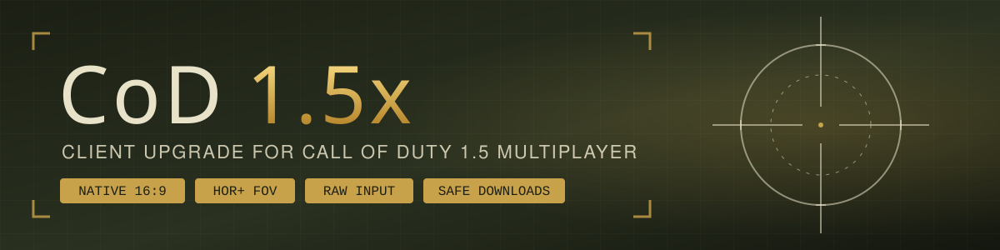

<p align="center">
  
</p>

<p align="center">
  <b>A client-side upgrade for Call of Duty (2003) multiplayer 1.5</b><br>
  Native widescreen resolutions, Hor+ FOV, raw mouse input, safer server downloads.<br>
  No patched game executable: drop in one DLL.
</p>

<p align="center">
  
  
  
</p>

> **Fork of [xtnded/codextended-client-1.5](https://github.com/xtnded/codextended-client-1.5)** (CoDExtended client 1.5x).
> All the original features are kept; this fork fixes bugs and adds the improvements below.

---

## ✨ What's new in this fork

### 🖥️ Display
| | |
|---|---|
| **Native resolution** | The stock game has no 16:9 modes at all. Your desktop resolution (e.g. 1920x1080) is now available as `r_mode 10`, and appears in the in-game **Video** menu with its real size. `r_mode 11` is native too. |
| **Hor+ widescreen FOV** | On 16:9 the stock game crops the top and bottom of the view. Now `cg_fov` is the 4:3 horizontal FOV, so widescreen keeps the full vertical view and gains on the sides (`cg_fov 80` → 96.4° at 16:9). Mouse sensitivity and sniper zoom feel unchanged. |
| **Correct refresh rate** | In fullscreen the game could fall back to 60 Hz on a 75/144 Hz monitor. Native modes now use your desktop refresh rate. |
| **Fixed borderless mode** | `r_borderless 1` rendered at an unrelated size inside a fullscreen window; it now renders at native resolution. Also fixed a memory corruption bug in the command. |
| **High-DPI aware** | Correct native resolution and a sharp window with Windows scaling at 125% / 150%. |

### 🖱️ Input
| | |
|---|---|
| **Raw mouse input** | `m_rawinput 1` reads the mouse directly (WM_INPUT), ignoring Windows pointer speed and "Enhance pointer precision". 1:1 aim at any polling rate. |

### 🛡️ Safety & stability
| | |
|---|---|
| **Blocks unofficial game DLLs** | The engine extracts `cgame`/`ui`/`game` DLLs from the highest-priority pk3, which can be one a server made you download, and loading a DLL runs its code. Only the official 1.5 DLLs are loaded now (SHA-256 checked *before* loading). `cl_allowCustomDlls 1` to allow others. |
| **Version-checked patches** | Patches are applied only to the official CoDMP 1.5 exe and cgame/ui builds, never to an unknown build that would crash. |
| **Your settings stick** | Recommended settings are applied once, not forced on every start. |
| **Leaner** | ~440 lines of dead code removed, including a string compare that ran on every audio call. |

### 📦 Install without patching the game
The original release shipped a modified `CoDMP.exe`. This fork installs as `mss32.dll` next to the **unmodified** game, the same approach used by [CoD2x](https://github.com/callofduty2x/CoD2x). `CoDSP.exe` and the United Offensive exes keep working untouched.

### 🎮 Kept from CoDExtended 1.5x
- FPS counter (`cg_xui_fps`, `cg_xui_fps_x`, `cg_xui_fps_y`)
- Discord Rich Presence (server, map, gametype, players)
- Unlocked `cg_fov`, `cg_thirdperson`, `cg_thirdpersonangle`
- Server-controlled FOV limits (`sv_fov_min` / `sv_fov_max`) and jump slowdown (`jump_slowdownEnable 0`)
- Alt-tab / minimize fix, no flickering when loading a map, no "too many visible models" spam, more hunk memory

---

## 📥 Install

You need an original, legitimately purchased copy of Call of Duty patched to **1.5**.

1. Extract **`install.bat`** and **`cod15x.dll`** from the release zip into your Call of Duty folder.
2. Double-click **`install.bat`** and choose **1 - Install / update**.
3. Start multiplayer: the bottom-right corner shows **1.5x 2044**.

The script renames your original Miles `mss32.dll` to `mss32_original.dll` and installs CoD 1.5x as `mss32.dll`. It asks for administrator rights when the game is under Program Files. Run it again to update, or choose **2 - Uninstall** to restore the original files.

```
Call of Duty\
├── CoDMP.exe              (unmodified)
├── mss32.dll              ← CoD 1.5x
└── mss32_original.dll     ← your original Miles mss32.dll
```

<details>
<summary>Manual install</summary>

Rename `mss32.dll` to `mss32_original.dll`, then copy `cod15x.dll` into the folder as `mss32.dll`. To uninstall, delete `mss32.dll` and rename `mss32_original.dll` back.
</details>

> Upgrading from the original release (`CoDMP.exe` + `cod5x.dll`)? Restore your original `CoDMP.exe` first.

## ⚙️ Settings

| Command / cvar | Default | Description |
|---|---|---|
| `r_mode 10` | | Native desktop resolution (shown in the Video menu). `r_mode 11` is the same. |
| `cg_widescreenfov` | `1` | Hor+ FOV on widescreen. `0` = stock behaviour. |
| `m_rawinput` | `0` | `1` = raw mouse input. You may need to retune `sensitivity`. |
| `r_borderless` | `0` | `1` = borderless window at native resolution. |
| `cg_xui_fps` | `1` | FPS counter; position with `cg_xui_fps_x` / `cg_xui_fps_y`. |
| `cl_allowCustomDlls` | `0` | `1` = allow non-official cgame/ui/game DLLs. Only for servers you trust. |
| `r_displayRefresh` | auto | Set it yourself to force a refresh rate. |

Example:
```
/r_mode 10
/m_rawinput 1
/vid_restart
```

## 🔧 Building from source

Visual Studio 2019 or newer with the **Desktop development with C++** workload (v142 toolset):

```
MSBuild cod5x.vcxproj /p:Configuration=Release /p:Platform=Win32
```

Output: `Release/mss32.dll` (shipped as `cod15x.dll` in the release zip, see `install.bat`). Old installs with a patched `CoDMP.exe` importing `cod5x.dll` still work if the file is named `cod5x.dll`.

## 🙏 Credits

- [xtnded / CoDExtended](https://github.com/xtnded/codextended-client-1.5): the original 1.5x client ([forum](http://xtnded.org), [Discord](http://discord.cod1x.eu))
- [CoD4x](https://github.com/callofduty4x/CoD4x_Client_pub): Discord Rich Presence reference
- [CoD2x](https://github.com/callofduty2x/CoD2x): the mss32 install approach

## ⚠️ Disclaimer

Unofficial, community-made modification, provided "as is" without warranty. Not affiliated with Activision or Infinity Ward. The Miles Sound System DLL is not included: you use the one from your own game.

## 📜 License

GNU General Public License v3.0 or later, as the original project. See [LICENSE](LICENSE).
